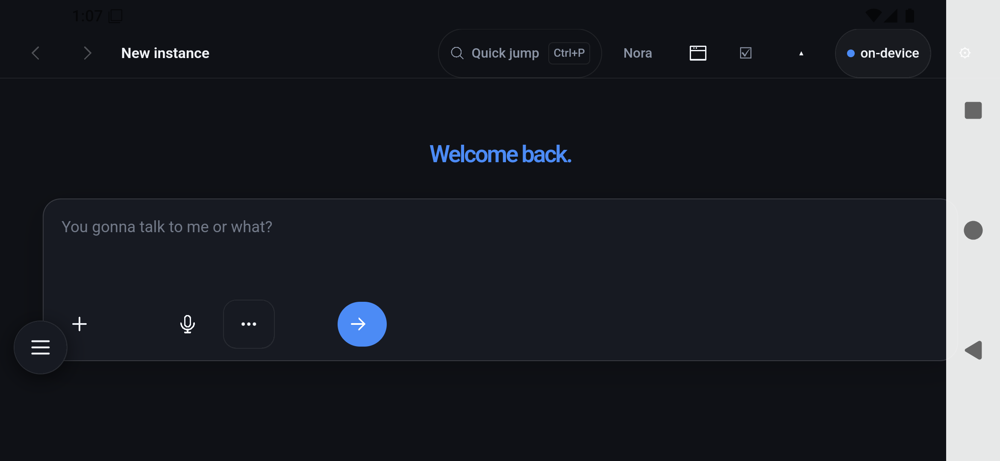
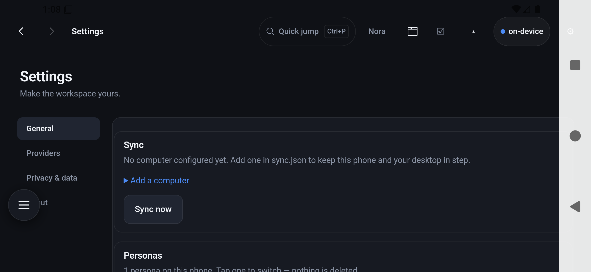
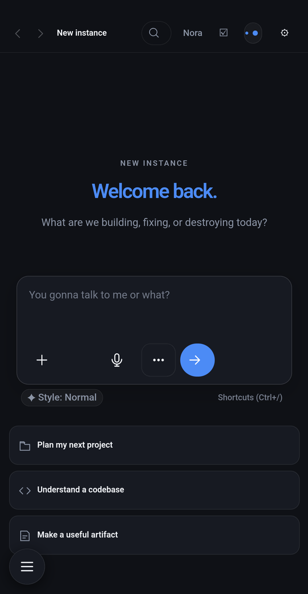
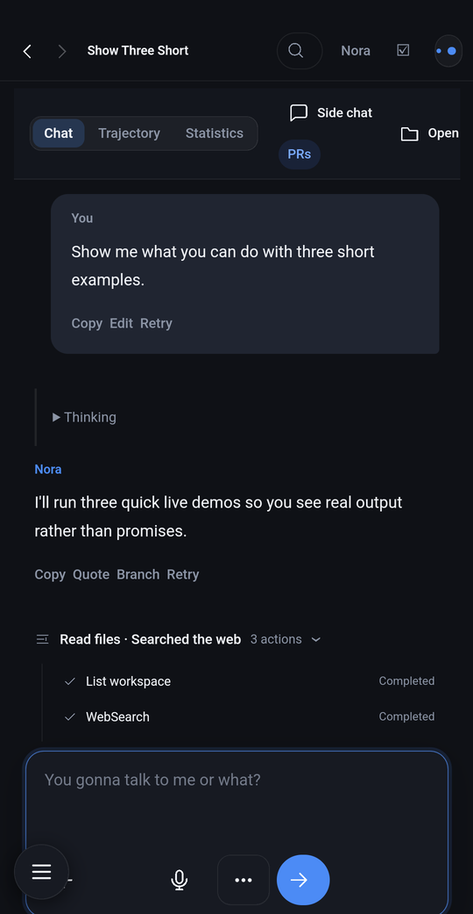
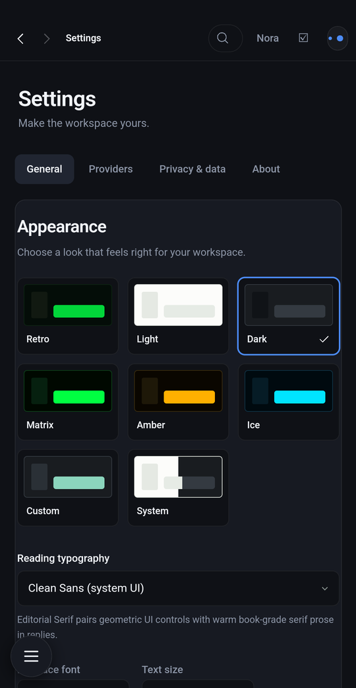
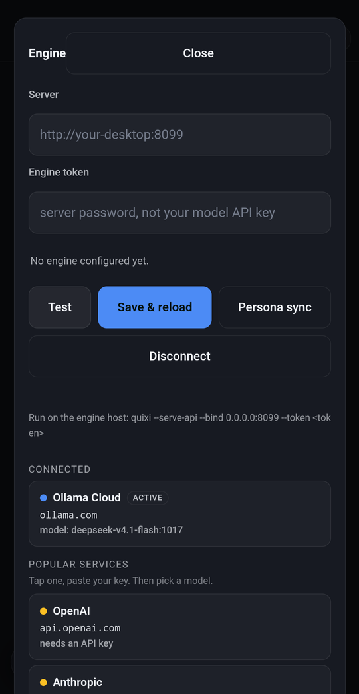

# QuixiDesk by Eric Hartford — volkdude85 edition

**Who wrote what:** [`docs/AUTHORSHIP.md`](docs/AUTHORSHIP.md) — Eric Hartford's software, and
what the Android edition adds to it.

Runs on ordinary Android and on GrapheneOS — a degoogled Android, which is the build it was mostly
tested on. The application is **Eric Hartford's**; this repository is the packaging, the install guide
and the sync, put together by volkdude85.

**QuixiDesk by [Eric Hartford](https://github.com/ehartford) — [QuixiAI/QuixiDesk](https://github.com/QuixiAI/QuixiDesk)** — the engine, the tools, the interface.
This repository is the *packaging*: the guide, the sync, and the tooling that puts his work on a phone
in a specific order. See [`CREDITS.md`](CREDITS.md) and [`docs/DEVELOPER-NOTES.md`](docs/DEVELOPER-NOTES.md).

> **Alpha.** This is working software that nobody else has used yet. The sync protocol has tests, the
> guide is accurate as of the build in this repository, and the app runs on three devices — but treat
> every number as "measured once, by one person". It is **open code**: read it, fork it, change it, ship
> your own. Nothing here is a locked product, and none of it needs permission.
>
> Not sure where to start? [`docs/DEPENDENCIES.md`](docs/DEPENDENCIES.md) says what you need,
> [`docs/SYNC.md`](docs/SYNC.md) explains the sync, [`docs/IOS.md`](docs/IOS.md) is what an iOS port
> would take, and [`docs/TESTING.md`](docs/TESTING.md) says what has actually been checked.

Documentation and tooling for running QuixiDesk entirely on an Android phone:
the engine, the persona, the tools and the mail reader live inside the app, so it works in a pocket on
mobile data with no computer involved.

This repository is **not** the application source. It is the part that makes the application usable by
someone who did not build it: a photographed setup guide, the two-way sync service for a Windows or
Linux desktop, and the scripts that regenerate both.

```
docs/guide/        the setup guide — 16 pages, PDF and source, every figure regenerable
docs/DEVELOPER-NOTES.md  who did what, the conventions in the tree, what is missing
docs/BROWSERS.md   Brave and Firefox: privacy defaults and debugging worth using
docs/COMPUTER.md   what to have on the desktop, with the download link for each
docs/PUBLISHING.md the name, the pre-push checklist, and what never goes in
docs/DEPENDENCIES.md  what it needs, what it wants, what it refuses to depend on
docs/SYNC.md       the sync protocol: what it guarantees, and the numbers behind it
docs/IOS.md        what an iOS port would actually take, and the part that will be refused
docs/TESTING.md    how claims are checked — real path, second pass, byte-identical, geometric layout
docs/BACKGROUND-SYNC.md  what Android allows for a sync that happens by itself, and the plan
docs/SECURITY-POSTURE.md the five ways this actually hurts someone, and the answer to each
ci/ci.sh           the gate: syntax, identifier scan, guide rebuild with drift check, figures
docs/AI-HANDOFF.md written for whoever picks this up next — invariants, layout, honest gaps
docs/screenshots/  product shots, taken from a device and cropped to the app surface
docs/VISIT-CHECKLIST.md   what to take and the order to do it in, when setting up someone else's phone
sync/              the desktop half of the sync: one Python file, no dependencies
tools/             the scripts that build the guide and scan the package for identifying material
DESIGN.md          what was built, why, what it cost, and what is unfinished
SCAN-REPORT.md     what the identifier scan looks for, and its result at packaging time
```


## Install it

The build in this repository is [`release/QuixiDesk-public-arm64.apk`](release/QuixiDesk-public-arm64.apk) —
arm64, signed, one persona (the public edition), no memory of anyone. Verify it first if you like:

    cd release && sha256sum -c SHA256SUMS

Then, on the phone: Settings → About phone → tap **Build number** seven times, Developer options →
**Install unknown apps** for whatever you transfer with, copy the `.apk` over, and tap it. The
screenshots for every one of those steps are in [`docs/guide/`](docs/guide/).

If you would rather build it yourself, `PERSONA=public-nora ./build-apk.sh arm64 release` in the
source tree does the same thing and refuses to finish if the package carries anything it should not.

## Change it

The persona is one file, not a rebuild. In the app: **Settings → Personas** lists every persona on the
phone, switches with a tap, keeps a copy of the one in use before switching, and accepts a new one
pasted in as text. On a computer the same idea is `~/.quixi/persona.md`.

The package ships **one** persona — the public edition — and the build refuses to finish if a second
one appears or if any identifying material is inside the APK. What you do with it after that is yours:
rename it, rewrite it, replace it.

## Landscape

A phone gets turned sideways, and the first version of this app did not survive it — the composer fell
off the bottom of a 480 px viewport. These are from the release build, on the emulator, rotated with a
system setting rather than a gesture.

| Home, landscape | Settings, landscape |
|---|---|
|  |  |

What changed for it: a `(max-height: 520px)` compact rule hides the decorative rows, the sidebar
collapses, and the composer keeps its full width and all four buttons. The conversation gets the
height, not the furniture.

## About the snark

The assistant mutters while it works — a rotating title line on the home screen, and a running commentary
while a turn is in flight. That is in here **for shits and grins**. It is not aimed at anyone.

Every line lands on the software, the situation, or the speaker — never on the person using it. That rule
is written at the top of both files that hold the lines, and it is the reason they are safe to read with
your mother looking over your shoulder.

If any of it did offend or hurt someone: our apologies, genuinely. Nothing here is worth a bad afternoon.
Shake it off, go touch some grass, give a loved one a hug, and move on with life.

If you would rather have an assistant that never jokes, the pool is one array in one file — delete the
lines and it goes quiet, no code changes required.

## What it looks like

| | | |
|---|---|---|
|  |  |  |
| The whole assistant in a pocket | Tools running for real, not promised | Themes, typography, per-device preferences |
|  | | |
| Pick a service, paste a key, choose a model — or point it at your own machine | | |

Screenshots are taken from a real device with the status bar and navigation bar cropped away, and are
regenerated by the same scripts as the guide. The persona name in the top bar is whatever that build
was compiled with; it is a build parameter, not a hard-coded feature.

## What the app does

* Runs an assistant on the phone itself — no server, no account required for local use.
* Reads mail by driving the provider's own web page, which is what makes a free Proton account usable
  from a phone app at all (free Proton has no IMAP and no SMTP).
* Syncs its memory, persona and preferences with a desktop on the same network. Neither side is the
  master: the newer copy wins, the older one is kept, and the two converge.


## How it fits together, in one page

```
┌─────────────────────────── phone ───────────────────────────┐
│  Tauri shell (Rust)                                          │
│   ├── engine + tools, compiled in as a static library         │
│   ├── the persona and memory, seeded on first run             │
│   └── one web view: the interface, and the mail page it drives │
└───────────────┬──────────────────────────────────────────────┘
                │  plain HTTP, LAN only, token-gated
┌───────────────▼─────────────── desktop ──────────────────────┐
│  room daemon (Python, no dependencies)                        │
│   ├── /api/state   which machines are alive, on which engine  │
│   ├── /api/send    message relay between agent instances      │
│   └── /api/sync/*  deterministic file sync  ← this project    │
└───────────────────────────────────────────────────────────────┘
```

Three ideas carry the whole design, and each one is a decision rather than a default:

* **The engine runs on the phone**, not on a desktop reached over the network. A companion that stops
  working when you leave the house is not a companion.
* **Mail is read by driving the provider's own page** inside the app, because free Proton has no IMAP
  and no SMTP. The password is only ever typed into the provider's form, never into a screen we drew.
* **Sync converges; it never overwrites.** State resolves by recency with the loser kept, conversations
  are unioned by id and never shortened, and there is no delete verb.

The reasoning, the costs and the measurements behind each: [`DESIGN.md`](DESIGN.md),
[`docs/SYNC.md`](docs/SYNC.md), [`docs/TESTING.md`](docs/TESTING.md).

## Where it stands

| Piece | State |
|---|---|
| App on a phone: chat, tools, persona, memory | **working** — Android 14 / 16 / 17, two OEMs and an emulator |
| Mail (page-driven, free Proton included) | **working** — read, open, compose; the final send is a human tap by design |
| Sync: state and conversations, many chats both ways | **working** — 50 conversations, zero differences, second pass a no-op |
| Sync: your own files (PDFs, video) | **working** — 40 MB verified byte-identical both directions |
| Sync settings on the phone: add a computer, run a pass, see what happened | **working** — three fields and a button, no shell involved |
| Background sync (hourly, unmetered only) | **built** — a WorkManager job calls the same library code; a forced run was accepted by the system, end-to-end execution not yet observed |
| Resume a transfer that dropped mid-file | **not built** — a dropped upload restarts. The known cost of the biggest files |
| Calendar | **not wired up** — the client exists, the account plumbing does not |
| iOS | **nothing** — [`docs/IOS.md`](docs/IOS.md) is the map, not the territory |

## How we recommend using it

* **Give it a job.** It is best at "look at this and tell me", "fix this and prove it", "read these and
  summarise". It is not a search engine and it will not know today's news unless you let it fetch.
* **Let it use tools.** The reason this is worth carrying is that it can run commands, read files and
  check its own work. A chat-only assistant is a worse chatbot.
* **Keep one machine as the source of truth for documents**, and let sync carry the state. Two people
  editing the same file on two devices is the one thing a converge-style sync cannot solve for you.
* **Turn USB debugging off when you are done.** It is a workshop door.
* **Change anything.** The persona is a file, the sync root is a flag, the whole thing is a few thousand
  lines of readable Rust and JavaScript. If you disagree with a decision in `DESIGN.md`, fork it and
  prove yourself right — that is what it is for.

## Requirements

| For | You need |
|---|---|
| Running it on a phone | Android 10 or newer, ~1 GB free, and either an API key for a model service or a model server on your LAN |
| Building the app | Rust with Android targets, JDK 21, the Android NDK, the Tauri CLI (see `docs/guide`, Appendix A) |
| Running the desktop sync | Python 3 — nothing else |

## Install, in short

1. Build the APK (Appendix A of the guide) or obtain one from whoever builds it.
2. Copy it to the phone, tap it, allow installing from that source.
3. Open it, set a model service in the app's settings, and optionally sign in to mail once.
4. Full walkthrough with screenshots: [`docs/guide/QuixiDesk-Android-Guide.pdf`](docs/guide/QuixiDesk-Android-Guide.pdf).

## Desktop sync, in short

On the desktop:

```bash
python sync/sync_server.py --root ~/QuixiDesk --token <a-long-random-string>
```

On Windows, double-click `sync/windows/start-sync-server.cmd` after putting your token in it.

On the phone, one file in the app's private storage points at it — one entry per computer, because a
person may have more than one and the phone should not have to be told which one it is near:

```json
{ "homes": [
    { "name": "study", "url": "http://192.168.1.50:8788", "token": "…" },
    { "name": "cabin", "url": "http://10.0.0.20:8788",  "token": "…" }
] }
```

The app syncs every time it opens, trying each computer in turn with a three-second timeout, so one
that is switched off costs three seconds and does not block the other. `sync/set_sync.py` writes that
file over adb so nobody has to type a path into a device shell. The full protocol is in
[`docs/SYNC.md`](docs/SYNC.md).

### What syncs, and what never does

| Syncs | Never syncs |
|---|---|
| `memory/MEMORY.md`, `memory/USER.md`, `memory/FAMILY-REFERENCE.txt` | passwords, API keys, provider credentials |
| `persona.md` | sessions, transcripts, workspace files, artifacts |

The server serves a fixed list of paths, refuses anything outside it, refuses `../`, and refuses to
answer without the token.

### Measured behaviour

Run against a real phone, both directions:

```
pass 1   pushed 3 · pulled 1 · errors 0
pass 2   pushed 0 · pulled 0 · errors 0      ← converged
```

A file edited on the desktop was pulled on the next pass; the copy it replaced was kept as
`persona.md.conflict-<machine>-<timestamp>`. Nothing is deleted by a sync, ever.

## What is deliberately not in this repository

* **No private build.** The APK in [`release/`](release/) is built from the public persona with no
  memory of anyone, and the build refuses to produce one that carries a second persona or identifying
  material. What is *not* here is any build made from somebody's own persona and memory — that is
  theirs to keep, and rebuilding it is one command: `PERSONA=… ./build-apk.sh arm64 release`.
* **No credentials, keys, tokens or addresses.** The scanner in `tools/doxcheck.py` fails the build
  if they appear; see `SCAN-REPORT.md`.
* **No upstream application source.** This kit documents and wraps the app; it does not redistribute it.

## Regenerating the guide

```bash
/usr/bin/python3 tools/build_guide.py     # renders and re-stamps the contents page from measurements
/usr/bin/python3 tools/doxcheck.py docs/guide/guide.html docs/guide/QuixiDesk-Android-Guide.pdf
```

`tools/capture.sh` re-takes the device screenshots; `tools/annotate.py` redraws the callouts. Every
figure is generated, so a UI change means re-running two commands rather than editing images by hand.

## Licence

Tooling and documentation: MIT (`LICENSE`). The guide text and figures: CC BY 4.0.
QuixiDesk itself is a separate project with its own licence and its own repository; nothing of it is
redistributed here. Upstream: https://github.com/QuixiAI/QuixiDesk
