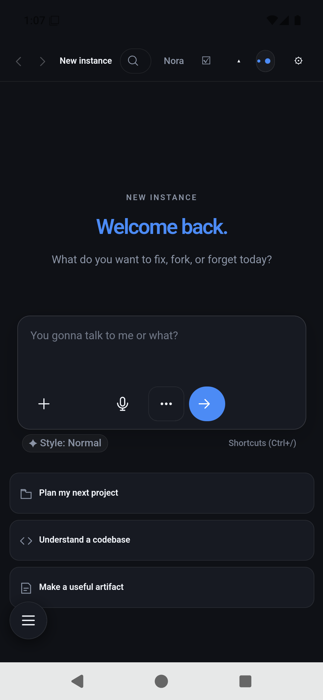
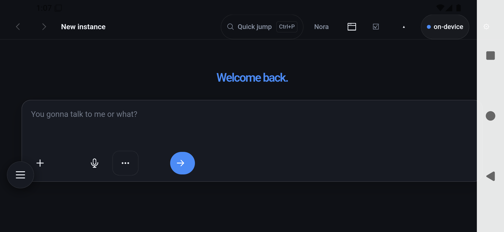
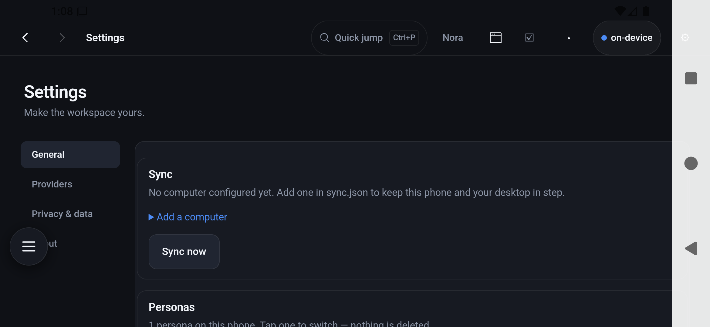
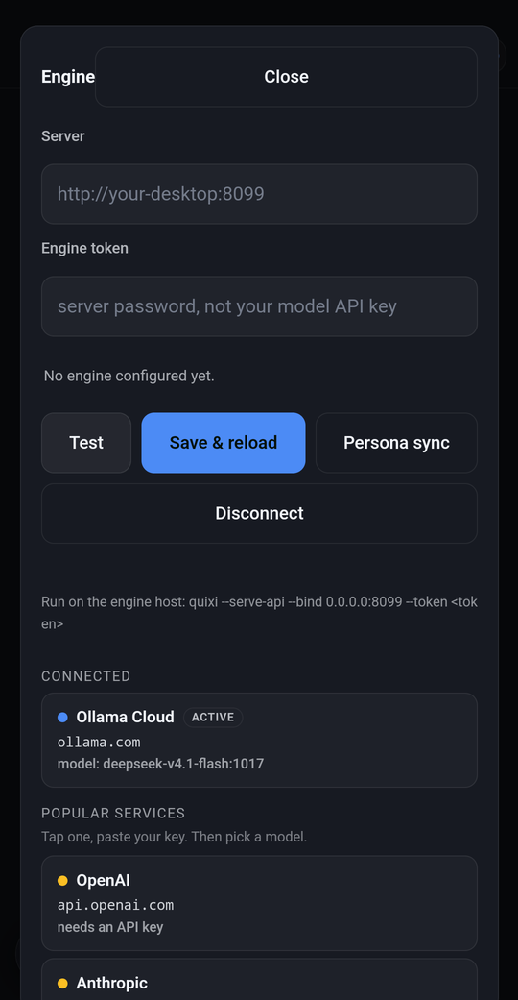
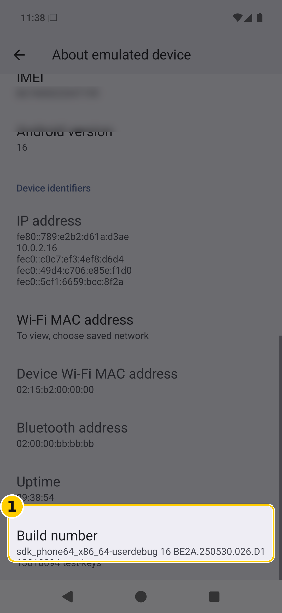
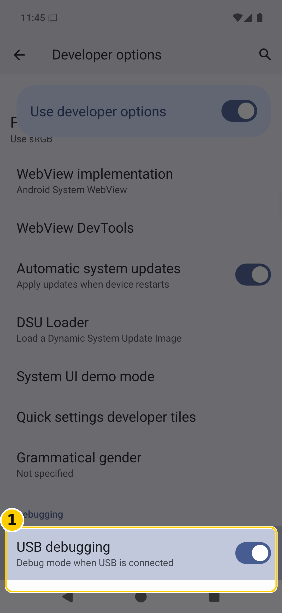

# Field notes: the ugly parts

Everything below was hit for real while getting this running on a **Samsung handset (Android 16) from a
Windows 11 host over USB**, and again on a Pixel, and again on a de-Googled phone. It is written in the
order the problems actually bite, because that is the order you will meet them.

Nothing in here identifies a person, a machine or a network. Where a detail would, it is described by
its shape instead: "the handset", "the host", "the LAN address of your own computer".

> "Installing that on a phone from scratch sucked — and I'm the guy that created it."
>
> The person who put this package together, after a full evening of it. Nothing below contradicts that
> sentence: this is not a smooth product yet. It is a working one with sharp edges, and the edges are
> documented here so they can be filed down instead of discovered.

If you only read one section, read **1** — it is the one that makes people think the software is broken
when it is working exactly as designed.

### What it looks like when it is working

| Portrait | Landscape |
|---|---|
|  |  |

| Settings, landscape | Landscape, second pass |
|---|---|
|  |  |

If your handset does not look like this — if the composer is cut off, or the header has no persona name —
you are in section 1 or 2 below, not looking at a different product.

---

## 1. The provider says "Connected" and every turn still fails

**Symptom.** The providers screen shows a healthy provider with hundreds of models available. Every
message comes back with *"No connected provider returned a response. Check Providers and try again."*
Token counters sit at 0 in / 0 out.

**Why.** The model is pinned **per session**, not per provider. Each session file carries its own `model`
field. A conversation created during onboarding keeps whatever the onboarding default was — often
something the user never chose — and changing `activeProvider` / `activeModel` in the provider settings
does not rewrite existing sessions.

There is a second half to it: a provider can be marked `configured: true` with **an empty key**, and sit
at priority #1. It then outranks the provider that actually has a credential, and `activeProvider`
snaps back to it on the next start.

**Fix, in the product:**

- Switching providers must migrate open sessions, or at minimum the error must name the model it tried.
  "Check Providers" sends the user to a panel that insists everything is fine.
- `configured` should mean *has a usable credential*, not *was selected once during setup*.
- A provider with no key should never outrank one with a key.

**Fix, if you are stuck right now:** start a fresh conversation after changing the provider, and check
the session file for a `model` field that names the old one. Delete that conversation; it will never
recover on its own.

*This is the panel the error sends you to. It is not lying: the provider really is configured. The
conversation is the thing pointing somewhere else.*

---

## 2. The persona looks loaded and is not

**Symptom.** The header shows the persona's name. The assistant introduces itself as the stock product
and denies knowing anything about its user.

**Why.** There are two files and they do different things:

| File | What it actually does |
|---|---|
| `.quixi/persona.md` | supplies the **display name** only (the UI reads it into `localStorage`) |
| `workspace/AGENTS.md` | supplies the **system prompt** — this is what the model is told it is |

With `persona.md` filled and the workspace empty, you get a correct-looking header over a generic
assistant. Writing the persona **and the memory** into `workspace/AGENTS.md` fixes it immediately.

**And note:** `pm clear` wipes `AGENTS.md`. The persona silently reverts to nothing after a data clear,
with the header still showing the old name if the label file survives.

**Fix, in the product:** either read `persona.md` as the prompt, or say plainly in the UI that
`persona.md` is a label and `AGENTS.md` is the prompt. Right now the app implies the opposite.

*The header can be right while the assistant is wrong. That is the whole trap.*

---

## 3. Saving a key silently does nothing if you call the API with the wrong arity

**Symptom.** "The key didn't save." The provider still shows no credential, and the error points at
authentication, not at the call.

**Why.** `window.quixiApi.call(path, options, body)` takes **three** arguments. Pass the body as the
second argument and the engine receives nothing, then saves against whatever provider happens to be
active. Nothing throws.

**Fix, in the product:** throw on an empty body. It would have saved hours.

Worth saying: a correctly saved key leaves **no plaintext** in `providers.json` — only a mask like
`00f574••••4x7v`. That part is right, and it is also why "did it save?" cannot be answered by reading
the file.

---

## 4. Signing changes and Android's quiet data-loss traps

Three separate traps, all of which report success:

- **`bmgr backupnow <pkg>`** reports Success with a real byte count. **`bmgr restore <token> <pkg>`**
  reports `restoreFinished: 0 / Restore complete` — and the app's data directory comes back **empty**.
  It clears the package first and restores nothing. No error, no warning.
  `adb backup` is no rescue either: on a modern Android it writes a **47-byte stub**.
- **A signature change silently breaks the credential store.** Android Keystore entries are bound to the
  signing certificate. Install a debug-signed build over a release-signed one and key saves stop
  working with `configured: true`, an empty mask, and no error anywhere. Only a fresh data directory
  (new Keystore keys) makes saving work again.
- **`INSTALL_FAILED_UPDATE_INCOMPATIBLE`** on any signature change: the only path is uninstall, which
  destroys the data, and there is no export.

**What to do instead:** treat app data as expendable *before* you start testing, keep the persona and
memory as files you can re-seed, and never plan a workflow that depends on `bmgr restore`.

---

## 5. The Windows half: what actually fights you

Sideloading from Windows is not one permission prompt. It is a sequence, and every step fails
*silently* or with a message that names the wrong thing.

1. **Developer options are hidden.** Tap *Build number* seven times. On several OEM builds the entry sits
   under a differently-named menu than the guides assume.
2. **USB debugging must be on, and the host key must be authorised** — the prompt for that appears on the
   *phone*, sometimes behind the lock screen, and expires. If `adb devices` shows `unauthorized`, that
   prompt is waiting, not broken.
3. **Samsung's Auto Blocker is a second gate on top of "install unknown apps."** It blocks sideloading —
   and `adb install` with it — at the OS level. The guides that say "allow unknown sources and go" are
   wrong on this hardware. It has to be turned off deliberately, and the setting is not in the same place
   as the per-app unknown-sources toggle.
4. **The file has to be somewhere the installer can see.** `adb push` to the download directory, then
   install from the phone's own file manager, is more reliable than `adb install` on locked-down builds.
   Both work; one gives better error messages when it fails.
5. **The ABI must match.** An `arm64-v8a` build will refuse to install on an `x86_64` emulator with
   `INSTALL_FAILED_NO_MATCHING_ABIS`. That is not a broken APK; it is the wrong APK for the target. Build
   both, and label them.

**Time cost, honestly:** the software part is minutes. The trust-and-permissions part is where an evening
goes — and it is entirely avoidable with a written sequence.

| The seven taps | Where USB debugging lives |
|---|---|
|  |  |

Two screens worth recognising on sight: the *Build number* row you tap seven times, and the *USB debugging*
toggle that appears afterwards. Neither is memorable, and both are in the guide with callouts.

---

## 6. Voice input is missing on de-Googled phones, and nobody says so

**Symptom.** The microphone button produces silence, or nothing at all.

**Why.** The Android build carries no speech code of its own. The mic reaches the WebView's
`getUserMedia`, and recognition is whatever the system provides. On a Google handset that is Google's
recogniser, already installed and tuned to the user's voice. On a de-Googled build it is often **absent
entirely**.

This is also why a desktop speech pipeline cannot simply be copied across: bundling a second recogniser
means two engines competing for the microphone, and the OS one usually wins or breaks the app.

**What to build instead:** detect first, then choose.

1. If the device has a system recogniser, use it — it is better tuned and costs no download.
2. If it does not, offer an on-device fallback as an optional download.
3. Never bundle an engine that fights the platform one.

---

## 7. Where the interface stops being a phone interface

The settings surfaces — providers, engine, workspace — are the desktop application's panels squeezed
onto a handset. They work, and they read as a desktop app in a phone costume: dense sheets, stacked
overlays, controls sized for a cursor.

That is a redesign, not a bugfix, and it should not be smuggled into a release as one. What it needs:

- one list of settings, one screen per thing, no nested overlays;
- tap targets that assume a thumb, not a pointer;
- the provider/model choice stated once, plainly, where a turn can see it.

---

## What this repository changed because of the above

Not theory — these are in the tree:

| Fix | Where |
|---|---|
| The build stages the live interface into the Android assets every time, and refuses to ship a stale one | `build-apk.sh` |
| The interface is hashed, not mtime-compared, before deciding to re-embed it | `build-apk.sh` |
| Stale Gradle-merged assets are deleted before every build — the reason an old UI kept shipping | `build-apk.sh` |
| A persona and its memory are staged from one folder, and the build fails if a second persona or identifying material is inside the APK | `build-apk.sh`, `tools/apk-scan.sh` |
| R8 keep rules, written by the build, so release builds stop dying at launch on `androidx.startup` | `build-apk.sh` → `proguard-nora.pro` |
| The public build stages an empty credential file; a private build seeds its own and skips the publish scan, loudly | `build-apk.sh`, `PRIVATE_BUILD=1` |
| The guide gained Auto Blocker, the authorisation prompt, and the ABI note | `docs/guide/`, `docs/COMPUTER.md` |

---

## If you are doing this again, in order

1. Read **1** and **2** before you touch the phone. They are the two failures that look like the software
   being broken.
2. Keep the persona and memory as files on the host, so re-seeding is a copy, not a rebuild.
3. Expect the trust/permission sequence to take longer than the install, and follow section 5 rather than
   the generic guides.
4. Test the microphone early. If the handset has no recogniser, you will not discover it by reading the
   settings.
5. Never rely on `bmgr restore`.

---

## Developers' gripes (verbatim)

Not polished, on purpose — the complaints are more useful unedited than tidied up.

> "The ADB shit was pissing me off so much."

Between host-key authorisation prompts that hide behind a lock screen, an OEM blocker sitting on top of
the "unknown sources" toggle, and error messages that name the wrong layer, the transport fights you
harder than the software does.

> "It always takes me a second to remember where the build information is on Android — you've got to tap
> seven times. I always have to have a little bit of a reminder, because it's not like I do this every
> single day."

Which is the whole argument for `docs/guide/`: nobody should have to remember. Tapping *Build number*
seven times to reveal developer options is not knowledge worth memorising, and needing a reminder is not
a skill gap.

> "Mom didn't have any of the developer packages installed. It was just kind of a bitch."

A phone that has never been used for development has none of the pieces: no platform tools, no trust
relationship with the host, nothing. That is the *normal* case, not the edge case, and the instructions
should assume it — because the person holding it is not going to install a JDK to send a message.

> "It was more of a motherfucker than it needed to be by a long shot. This needs to get smoother."

That is the standard, and it is the honest headline for this document. Everything here exists to make the
next attempt shorter.

**What "smoother" concretely means, so it is not just a mood:**

- one written sequence for a fresh Samsung handset on Windows, with the Auto Blocker step and the
  authorisation prompt in it, in order;
- no step that requires a terminal on the phone;
- the ABI stated on the download, not discovered at install time;
- a first run that comes up already configured — persona loaded, provider active — instead of asking the
  user to find three settings and a hidden file.

